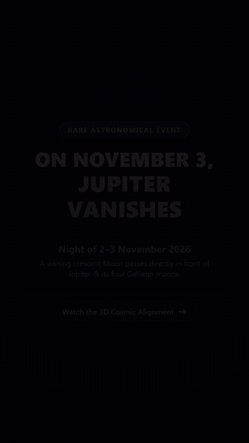

# Lunar Occultation of Jupiter (November 2–3, 2026)

On the night of Monday, 2 November 2026 into the early hours of Tuesday,
3 November 2026, the Moon will pass directly in front of Jupiter. This
repository provides two things:

- A calculation script (`compute.py`) using NASA/JPL DE440s ephemerides to
  derive exact topocentric contact times and observing geometry.
- A [Stellarium](https://stellarium.org/) script
  (`stellarium/jupiter-occultation.ssc`) to observe and animate the event from
  Bengaluru, India (or any configured location).



The animation shows the event from Bengaluru in mobile portrait format (720 × 1280 pixels, 9:16 aspect ratio, suitable for Instagram Reels and YouTube Shorts). It includes:
1. **Intro title card:** Event details, date, and observing location.
2. **Wide sky overview:** Eastern pre-dawn sky in Leo with constellation lines, horizon, and rising Moon & Jupiter.
3. **Telescopic context view (FOV 1.15°):** Continuous transit with subtle live HUD overlay (Bengaluru location, running IST time, and running Alt/Az for Jupiter and Moon).
4. **Zoomed close-up (FOV 0.20°):** High magnification showing Jupiter's disk, cloud belts, and Galilean moons, pausing for 1.5 seconds at each contact moment (Contact I, II, Mid, III, IV) with callout banners.

Full-resolution video:
- **[video/jupiter-occultation-portrait.mp4](video/jupiter-occultation-portrait.mp4)** (41 seconds, 720 × 1280 pixels, H.264, 30 fps).

## The Event

During early November 2026, the Moon is a 23-day-old waning crescent (approx.
34% illuminated) in the constellation Leo. Jupiter shines brightly at magnitude
-2.1 with an apparent disk diameter of 36.0 arcseconds.

### Key Visual Highlights

1. **Bright-Limb Ingress:** The Moon moves eastward across the sky. For a waning
   crescent, the leading eastern limb faces the Sun and is illuminated. Jupiter
   and its Galilean satellites disappear behind the sunlit edge of the Moon.
2. **Dark-Limb Egress:** Jupiter reappears from behind the Moon's unilluminated
   western limb. Because this side of the Moon is in shadow, Jupiter emerges
   dramatically out of empty black sky beside the lunar crescent.
3. **Observing Conditions from Bengaluru:** The event occurs in the early morning
   sky between 02:28 IST and 03:04 IST on 3 November 2026. The Moon and Jupiter
   climb from 20° to 28° above the eastern horizon, well placed for binoculars,
   telescopes, and astrophotography.

## Contact Timings (Bengaluru, India)

Coordinates: 12.9716° N, 77.5946° E, elevation 920 m.
Local time: Indian Standard Time (IST = UTC + 05:30).

| Contact | UTC Time | IST Time (3 Nov) | Altitude | Azimuth | Description |
|---|---|---|---|---|---|
| **C1** | 20:58:56 | 02:28:56 | 19.7° | 79.6° (E) | First contact: Jupiter touches Moon's bright limb |
| **C2** | 21:01:31 | 02:31:31 | 20.3° | 79.7° (E) | Full disappearance of Jupiter |
| **Mid** | 21:16:13 | 02:46:13 | 23.8° | 80.2° (E) | Maximum immersion (separation: 14.03 arcmin) |
| **C3** | 21:31:27 | 03:01:27 | 27.5° | 80.8° (E) | Jupiter begins emerging from dark limb |
| **C4** | 21:34:12 | 03:04:12 | 28.2° | 80.9° (E) | Full emergence of Jupiter |

- **Total occultation duration (C1 to C4):** 35 minutes 16 seconds.
- **Ingress transit duration (C1 to C2):** 2 minutes 35 seconds.
- **Egress transit duration (C3 to C4):** 2 minutes 45 seconds.

## Visibility Across Other Regions

| Location | Ingress (C1 UTC) | Egress (C4 UTC) | Duration | Min Sep | Local Time (C1) |
|---|---|---|---|---|---|
| **Bengaluru, India** | 20:58:56 | 21:34:12 | 35.3 min | 14.0' | 02:28 IST (3 Nov) |
| **Chennai, India** | 21:00:40 | 21:36:51 | 36.2 min | 14.0' | 02:30 IST (3 Nov) |
| **Colombo, Sri Lanka** | 20:51:04 | 21:53:46 | 62.7 min | 8.1' | 02:21 IST (3 Nov) |
| **Kuala Lumpur, Malaysia** | 21:20:55 | 22:37:16 | 76.4 min | 8.0' | 05:20 MYT (3 Nov) |
| **Singapore** | 21:26:06 | 22:45:41 | 79.6 min | 7.3' | 05:26 SGT (3 Nov) |
| **Jakarta, Indonesia** | 21:39:31 | 23:09:30 | 90.0 min | 2.8' | 04:39 WIB (3 Nov) |
| **Perth, Australia** | 22:45:59 | 23:58:35 | 72.6 min | 8.6' | 06:45 AWST (3 Nov) |
| **Sydney, Australia** | 23:40:31 | 00:38:43 | 58.2 min | 9.1' | 10:40 AEDT (3 Nov) |

## Watching in Stellarium

The script `stellarium/jupiter-occultation.ssc` sets up Stellarium at the
observer location, selects and tracks Jupiter, zooms in to a 0.65° telescopic
field of view, and animates the event with live HUD milestone status.

### 1. Copy the Script to Stellarium's Script Folder

#### Windows (PowerShell)
```powershell
New-Item -ItemType Directory -Force "$env:APPDATA\Stellarium\scripts"
Copy-Item "stellarium\jupiter-occultation.ssc" "$env:APPDATA\Stellarium\scripts\"
```

#### macOS
```bash
mkdir -p ~/Library/"Application Support"/Stellarium/scripts
cp stellarium/jupiter-occultation.ssc ~/Library/"Application Support"/Stellarium/scripts/
```

#### Linux
```bash
mkdir -p ~/.stellarium/scripts
cp stellarium/jupiter-occultation.ssc ~/.stellarium/scripts/
```

### 2. Run the Script in Stellarium

1. Open Stellarium.
2. Press **F2** to open the **Configuration window**.
3. Go to the **Scripts** tab.
4. Select **Lunar Occultation of Jupiter (November 2-3, 2026)** and click the **Run** button (play icon).
   *(Alternatively, press **F12** to open the Script Console, load the file, and press Run).*

### 4. Headless Mobile Portrait Video Generation

To generate the complete 41-second multi-segment mobile portrait video (title card, wide sky, telescopic transit with HUD, and zoomed close-up with contact pauses):

```powershell
uv run python make_segments.py
```

This automates the entire pipeline:
1. Generates the introductory title segment.
2. Captures wide-sky context in Stellarium (Leo, horizon, rising Moon/Jupiter).
3. Overlays running IST time and topocentric Alt/Az onto the telescopic transit.
4. Generates a high-magnification close-up on Jupiter, pausing for 1.5 seconds at each contact (C1, C2, Mid, C3, C4) with callout banners.
5. Assembles all segments into `video/jupiter-occultation-portrait.mp4` and creates an animated GIF preview.

## Running the Python Calculation

To recompute timings or test the math:

```powershell
uv run python compute.py
```

Run test suite:
```powershell
uv run pytest
```
